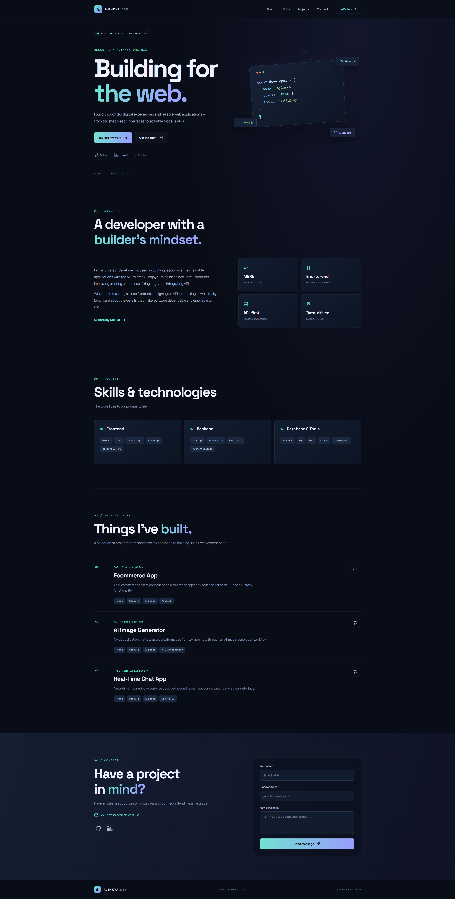

# 🚀 Personal Portfolio Website | MERN Stack

<!-- Tech Stack Badges -->
<p align="center">
  
  
  
  
  
  
  
</p>

<p align="center">
  A modern, responsive personal portfolio website built using the MERN stack to showcase my skills, projects, and experience as a Full-Stack Developer.
</p>

---

## 📸 Screenshots

### Home Page

<!-- Add your homepage screenshot here -->
<p align="center">
  
</p>

---

## ✨ Features

- **Modern UI:** Clean, professional dark-themed design with gradient accents.
- **Responsive Design:** Optimized for desktop, tablet, and mobile devices.
- **Hero Section:** Introduction with developer profile and social links.
- **About Me:** Personal introduction and development approach.
- **Skills Section:** Showcases frontend, backend, database, and development tools.
- **Projects Showcase:** Displays featured projects with GitHub repository links.
- **Contact Form:** Allows visitors to send messages directly through the website.
- **REST API:** Backend built with Node.js and Express.js.
- **MongoDB Integration:** Stores contact form submissions in MongoDB.
- **Form Validation:** Validates user input on both frontend and backend.
- **Rate Limiting:** Helps protect the contact endpoint from excessive requests.

---

## 🛠️ Tech Stack

**Frontend**

- React.js
- JavaScript (ES6+)
- HTML5
- CSS3
- Vite
- Lucide React Icons

**Backend**

- Node.js
- Express.js
- REST API
- Mongoose

**Database**

- MongoDB

**Development Tools**

- Git & GitHub
- VS Code
- npm

---

## 📂 Project Structure

```text
mern-portfolio/
│
├── client/
│   ├── public/
│   ├── src/
│   │   ├── data/
│   │   │   └── portfolio.js
│   │   ├── App.jsx
│   │   ├── main.jsx
│   │   └── styles.css
│   ├── .env.example
│   ├── index.html
│   └── package.json
│
├── server/
│   ├── src/
│   │   ├── models/
│   │   │   └── Message.js
│   │   ├── routes/
│   │   │   └── contact.js
│   │   └── index.js
│   ├── .env.example
│   └── package.json
│
├── screenshots/
│   ├── home.png
│   ├── about.png
│   ├── projects.png
│   └── contact.png
│
├── .gitignore
└── README.md
```

---

## ⚙️ Installation & Setup

Follow these steps to run the project locally.

### 1. Clone the Repository

```bash
git clone https://github.com/ajinkya029/mern-portfolio.git
```

```bash
cd mern-portfolio
```

### 2. Backend Setup

Navigate to the server directory:

```bash
cd server
```

Install dependencies:

```bash
npm install
```

Create a `.env` file using `.env.example`:

```env
PORT=5000
MONGODB_URI=mongodb://127.0.0.1:27017/ajinkya_portfolio
CLIENT_ORIGIN=http://localhost:5173
```

Make sure MongoDB is running or replace the connection string with your MongoDB Atlas URI.

Start the backend server:

```bash
npm run dev
```

Backend will run at:

```text
http://localhost:5000
```

### 3. Frontend Setup

Open another terminal and navigate to the client directory:

```bash
cd client
```

Install dependencies:

```bash
npm install
```

Create a `.env` file:

```env
VITE_API_URL=http://localhost:5000
```

Start the frontend development server:

```bash
npm run dev
```

Frontend will run at:

```text
http://localhost:5173
```

---

## 🔗 API Endpoints

| Method | Endpoint       | Description         |
| ------ | -------------- | ------------------- |
| GET    | `/api/health`  | Check API status    |
| POST   | `/api/contact` | Submit contact form |

### Contact API Request

**POST** `/api/contact`

Request Body:

```json
{
  "name": "John Doe",
  "email": "john@example.com",
  "message": "I would like to discuss a project."
}
```

Successful Response:

```json
{
  "message": "Message received.",
  "id": "mongodb_document_id"
}
```

---

## 🌐 Connect With Me

<p align="center">
  <a href="https://github.com/ajinkya029">
    
  </a>
</p>

---

<p align="center">
  ⭐ If you like this project, consider giving it a star!
</p>

<p align="center">
  Made with ❤️ by <strong>Ajinkya Dhatrak</strong>
</p>
